# Introduction to Network as Code (NaC)

<style>
.md-typeset h1,
.md-typeset h2,
.md-typeset h3,
.md-typeset h4 {
  font-weight: 700;
}
</style>

## Lab at a Glance

This hands-on lab demonstrates how **Network as Code (NaC)** applies declarative infrastructure management, automated deployment, and continuous validation to Cisco ACI.

While Cisco ACI is the implementation used in this lab, the underlying Network as Code principles extend to other network architectures and technologies.

| | |
|---|---|
| **Lab Environment** | Cisco ACI fabric — 2 Spines, 4 Leafs |
| **Technologies** | YAML, Terraform, nac-aci, nac-validate, nac-test |
| **Prerequisites** | Basic ACI knowledge, Terraform, Python, and access to an ACI fabric or simulator |
| **Deployment** | Node registration, OOB management, fabric/access policies, tenants, VRFs, and Bridge Domains |
| **Pre-Deployment Validation** | YAML schema validation, semantic checks, and custom compliance rules |
| **Post-Deployment Validation** | Automated configuration and health tests using Robot Framework |
| **Additional Concepts** | Terraform state management, configuration drift, and default value overrides |

**Learning Outcome:** By the end of this lab, readers will understand how to define network intent, validate proposed changes, deploy ACI configuration through Terraform, and verify the resulting infrastructure state.

### Getting Started — Reference Repositories

Cisco provides two official Network as Code repositories to help engineers begin their automation journey:

**1. Simple Example — Getting Started with NaC**

A minimal ACI configuration focused on tenant provisioning. Ideal for engineers exploring Network as Code for the first time.

[https://github.com/netascode/nac-aci-simple-example](https://github.com/netascode/nac-aci-simple-example)

**2. Comprehensive Example — Full ACI Fabric Configuration**

A more extensive example covering node registration, fabric and access policies, interface configurations, and tenant provisioning. Suitable for exploring broader ACI automation capabilities.

[https://github.com/netascode/nac-aci-comprehensive-example](https://github.com/netascode/nac-aci-comprehensive-example)

**Note:** The repositories and core NaC modules are publicly available. Some advanced `nac-validate` rules and `nac-test` templates demonstrated in this lab require access to Cisco Services as Code subscription resources.

---

Cisco Network as Code (NaC) is an automation approach that applies Infrastructure as Code (IaC) principles to network infrastructure. It uses declarative, human-readable data models to define the intended state of routers, switches, firewalls, and software-defined networks.

By representing network intent as code, configurations can be version-controlled, validated, tested, and deployed through automated workflows and CI/CD pipelines. This enables network changes to be delivered in a more consistent, repeatable, and auditable manner.

!!! info
    Infrastructure as code at a high level is the practice of provisioning and managing infrastructure through human-readable declarative data models rather than through manual processes.

## Network as Code for ACI

For many Cisco ACI deployments today, infrastructure is commonly provisioned through the APIC graphical user interface (GUI), REST API calls using tools such as Postman, automation frameworks like Ansible, or custom Python scripts. Each of these approaches has its place and continues to be valuable depending on the operational requirements.

The APIC GUI, in particular, provides an intuitive way to learn Cisco ACI, visualize policy relationships, and perform day-to-day operational tasks. However, as deployments grow from a handful of objects to hundreds or even thousands of tenants, VRFs, Bridge Domains, EPGs, contracts, and external connections, the operational challenge shifts. Engineers spend increasing amounts of time navigating between screens, creating dependent objects in the correct order, resolving validation faults after deployment, and manually ensuring that configuration remains consistent across environments.

Provisioning through the GUI can require extensive navigation across different areas of the APIC, where related objects must be created and connected in the correct sequence. Errors may only become visible after configuration has already been submitted, often through faults that engineers must investigate and resolve reactively. Meanwhile, isolated Postman collections, Ansible playbooks and Python scripts can gradually become separate automation islands, each managing only part of the infrastructure and potentially maintaining its own understanding of the network state.

The result is a familiar operational problem: manual processes (prone to human error), multiple tools, multiple configuration touchpoints, no single authoritative representation of the intended network, no record of network changes (lack of version control) and lack of extensive testing and validation.

This is where Network as Code changes the operational model. Rather than treating infrastructure as a collection of individual configuration tasks/actions, Network as Code allows the desired state of the network to be described declaratively, through a simplified, human-readable data model, validated before deployment, version-controlled, peer-reviewed, and deployed through repeatable automation pipelines.

The objective is not merely to configure ACI faster. It is to build a disciplined engineering lifecycle in which every proposed change can be reviewed, validated before deployment, applied consistently and tested afterwards to confirm that the declared intent has been pushed to the infrastructure and that the infrastructure has reached its intended operational state.

Terraform/OpenTofu can be used to serve as the automation engines which render the intended state defined by the user, into the actual API calls that will be sent to the network infrastructure (in this case; the APIC).

## Network as Code – Abstraction

Cisco ACI already provides a rich and highly programmable object model. Every tenant, VRF, Bridge Domain, EPG and contract is represented through managed objects that can be accessed through the APIC REST API.

This flexibility is powerful, but it also exposes engineers to a large amount of implementation detail. Direct API automation requires an understanding of object classes, distinguished names, parent-child relationships, attributes and dependencies.

The native Terraform provider simplifies this interaction by representing ACI managed objects as Terraform resources. However, engineers may still need to define multiple resources, references, loops and dependencies to express what is ultimately a relatively simple network requirement.

Cisco Network as Code introduces another layer of abstraction. Instead of defining every underlying ACI object individually, engineers describe the desired network configuration using a simplified YAML data model. The Network as Code Terraform module then translates that intent into the required ACI resources and API operations. This reduces time to value by abstracting away scripting syntax and low-level device configuration behind a curated, opinionated data model, so users can focus entirely on describing what they want configured.

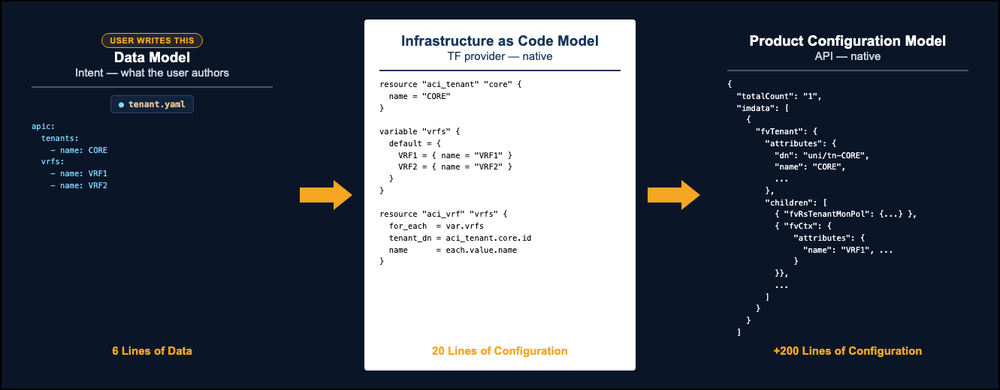

## Lab Setup

This lab consists of a two-spine, four-leaf Cisco ACI fabric in its initial, unconfigured state. Network as Code will be used to build and configure the fabric from scratch, transforming declarative network intent into an operational ACI environment.

## Network as Code Implementation

The workflow below demonstrates the stages involved in delivering ACI deployment and validation using Network as Code.

This workflow illustrates an end-to-end Network as Code (NaC) approach for deploying and validating Cisco ACI configuration. Network intent is first defined using a human-readable declarative data model, which describes the desired state of the fabric. Before any change is applied, `nac-validate` performs pre-deployment checks to validate the syntax, semantics, and compliance of the intended configuration. Once validation succeeds, Terraform translates the declared intent into the required ACI policy configuration and applies it to the fabric through the APIC API. After deployment, `nac-test` performs post-deployment validation to confirm that the configuration was successfully implemented and that the fabric is in the expected operational state. Together, these stages create a repeatable validation and deployment workflow in which network intent can be defined, verified, deployed, and tested consistently. Each stage is demonstrated in detail throughout the remainder of this document.

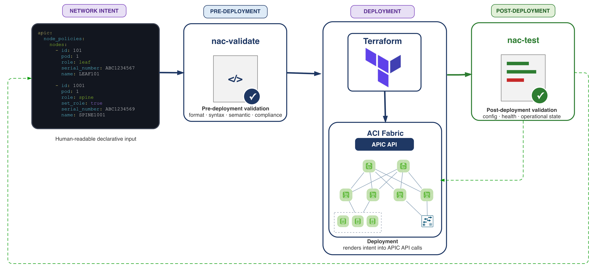

## Getting Started

### Pre-requisites

- Terraform installed on your development machine

    ```text
    nac-aci-terraform % terraform --version
    Terraform v1.15.8
    ```

- Python installed on your development machine
    - Python 3.11, 3.12 or 3.13 (required by `nac-validate` and `nac-test`)

- `nac-validate` and `nac-test` installed on your development machine

    ```bash
    pip install nac-validate nac-test
    nac-validate --version
    nac-test --version
    ```

- ACI infrastructure (real hardware or simulator)

Currently the ACI infrastructure does not have any nodes registered and does not have any pre-existing configurations. NaC will be used for this action.

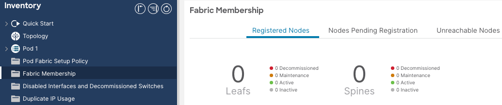

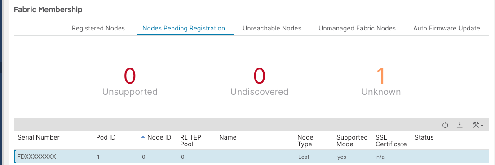

- Create a project folder in this structure.

    ```text
    nac-aci-terraform/
    ├── main.tf
    └── data/
        ├── apic.nac.yaml
        ├── defaults.nac.yaml
        └── node_policies.nac.yaml
    ```

| File | Description |
|------|-------------|
| `apic.nac.yaml` | Network as Code (ACI) configuration like enabling/disabling auto-generation of switch/interface policies, etc. |
| `defaults.nac.yaml` | Network as Code (ACI) defaults used to overwrite the defaults built into the Terraform Modules |
| `node_policies.nac.yaml` | ACI node registration, node management IP, update group, and vPC protection group configuration |

The intent for node registration, out of band assignment, vPC groups configs etc. is expressed in the `node_policies.nac.yaml`.

```yaml
---
apic:
  node_policies:
    vpc_groups:
      mode: explicit
      groups:
        - id: 1
          switch_1: 1001
          switch_2: 1002
        - id: 2
          switch_1: 1003
          switch_2: 1004

    nodes:
      - id: 1001
        pod: 1
        role: leaf
        serial_number: FDXXXXXXXX
        name: leaf1
        oob_address: 10.x.y.232/27
        oob_gateway: 10.x.y.225
        fabric_policy_group: ALL_LEAFS
        access_policy_group: ALL_LEAFS

      - id: 1002
        pod: 1
        role: leaf
        serial_number: FDXXXXXXXX
        name: leaf2
        oob_address: 10.x.y.233/27
        oob_gateway: 10.x.y.225
        fabric_policy_group: ALL_LEAFS
        access_policy_group: ALL_LEAFS

      - id: 1003
        pod: 1
        role: leaf
        serial_number: FDXXXXXXXX
        name: leaf3
        oob_address: 10.x.y.234/27
        oob_gateway: 10.x.y.225
        fabric_policy_group: ALL_LEAFS
        access_policy_group: ALL_LEAFS

      - id: 1004
        pod: 1
        role: leaf
        serial_number: FDXXXXXXXX
        name: leaf4
        oob_address: 10.x.y.235/27
        oob_gateway: 10.x.y.225
        fabric_policy_group: ALL_LEAFS
        access_policy_group: ALL_LEAFS

      - id: 201
        pod: 1
        role: spine
        serial_number: FDXXXXXXXX
        name: spine1
        oob_address: 10.x.y.236/27
        oob_gateway: 10.x.y.225
        fabric_policy_group: ALL_SPINES

      - id: 202
        pod: 1
        role: spine
        serial_number: FDXXXXXXXX
        name: spine2
        oob_address: 10.x.y.237/27
        oob_gateway: 10.x.y.225
        fabric_policy_group: ALL_SPINES
```

The YAMLs definition is not random. It is guided by the official data model which can be accessed from here: [https://netascode.cisco.com/docs/data_models/](https://netascode.cisco.com/docs/data_models/). The figure below shows an example of an ACI node registration data model. A user defining a YAML file can see what objects are supported, mandatory/optional, default values etc.

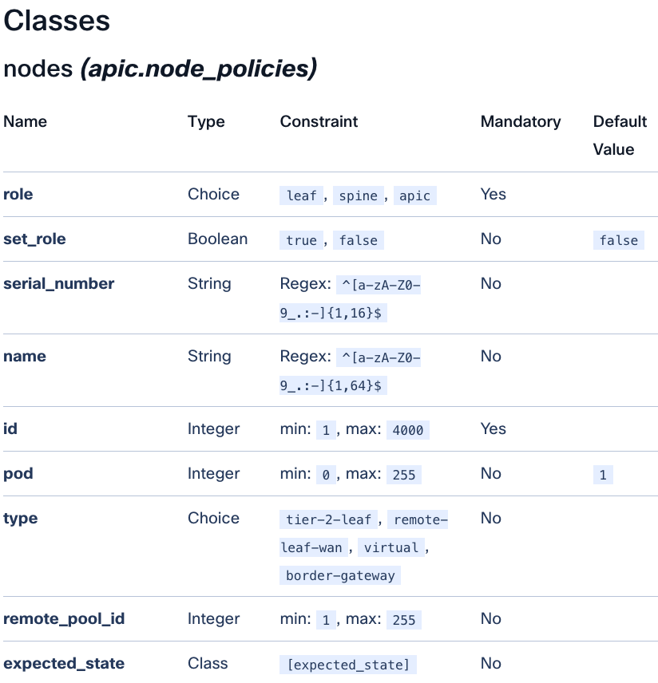

The `nac-aci` module is the key centerpiece that ties the data in the YAML file to the terraform provider for ACI that will be used to configure ACI. The module defines the terraform code, required logic, loops, resource dependencies which translates the data defined in the YAML file into the respective APIC calls for ACI automation.

This module is publicly available in the terraform registry: [https://registry.terraform.io/modules/netascode/nac-aci/aci/latest](https://registry.terraform.io/modules/netascode/nac-aci/aci/latest)

The module is defined in the `main.tf` file

```hcl
module "aci" {
  source  = "netascode/nac-aci/aci"
  version = "2.0.0"

  yaml_directories = ["data"]

  manage_access_policies    = false
  manage_fabric_policies    = false
  manage_pod_policies       = false
  manage_node_policies      = true
  manage_interface_policies = false
  manage_tenants            = false

  write_default_values_file = "defaults.yaml"
}
```

As seen from the `main.tf` file, the directory where the YAML files lie is defined, along with the specific objects that the user wants to manage using terraform. For now node_policies have been marked to true which means anything else that lies outside of the node_policies data model will not be considered for provisioning.

Now that the data is ready, provide infrastructure credentials (in this case APIC) as environment variables. These variables are required by terraform to communicate with the ACI infrastructure.

```bash
export ACI_USERNAME=admin
export ACI_PASSWORD='APIC_PASSWORD'
export ACI_URL=https://APIC-IP
```

Instead of exporting credentials in your shell, they can be retrieved from a secrets manager such as HashiCorp Vault and injected as environment variables at runtime, so nothing is left in your shell history. Values in the YAML data model can then reference them with the `!env` tag (for example, `password: !env APIC_PASSWORD`). Note that an unset variable resolves to an empty string rather than raising an error.

So far, the development environment just has the files (YAML and `main.tf`) but without the modules installed the environment has no capabilities to push configurations to ACI. Hence, the next step is to initialize Terraform to download all the required provider modules that are required for execution.

### Initialize Terraform

```bash
terraform init
```

This will pull the required terraform providers along with the `nac-aci` module code from the registry.

```text
nac-aci-terraform % terraform init
Initializing the backend...

Initializing modules...
Downloading registry.terraform.io/netascode/nac-aci/aci 2.0.0 for aci...
- aci in .terraform/modules/aci
…

Initializing provider plugins...
- terraform.io/builtin/terraform is built in to Terraform
- Finding hashicorp/local versions matching ">= 2.3.0"...
- Finding ciscodevnet/aci versions matching ">= 2.0.0, >= 2.5.0, >= 2.13.0, >= 2.15.0, >= 2.17.0, >= 2.19.0"...
- Finding netascode/utils versions matching "2.0.0"...
…
Terraform has created a lock file .terraform.lock.hcl to record the provider
selections it made above. Include this file in your version control repository
so that Terraform can guarantee to make the same selections by default when
you run "terraform init" in the future.

Terraform has been successfully initialized!

You may now begin working with Terraform. Try running "terraform plan" to see
any changes that are required for your infrastructure. All Terraform commands
should now work.
```

After terraform has been initialized, a `.terraform` folder will appear in the working directory. This folder contains the aci module and all its dependencies required to successfully interpret the YAML data and translate that into actual configuration elements.

```text
.terraform/
├── modules/
│   ├── aci/
│   └── modules.json
└── providers/
    └── registry.terraform.io/
        ├── ciscodevnet/
        ├── hashicorp/
        └── netascode/
```

### Plan and apply

Now it's time to generate a dry run of what will be provisioned to the infrastructure. This is achieved by running the `terraform plan` command. This command allows terraform to query the actual state of the infrastructure, compares it to what has been defined as the desired state and from there the plan of what objects need to be added/remove/modified such that the infrastructure matches the desired state.

```bash
terraform plan
```

```text
nac-aci-terraform % terraform plan

Terraform used the selected providers to generate the following execution plan. Resource actions
are indicated with the following symbols:
  + create

  # module.aci.module.aci_node_registration["1002"].aci_rest_managed.fabricNodeIdentP will be created
  + resource "aci_rest_managed" "fabricNodeIdentP" {
      + annotation  = "orchestrator:terraform"
      + class_name  = "fabricNodeIdentP"
      + content     = {
          + "extPoolId" = null
          + "name"      = "leaf2"
          + "nodeId"    = "1002"
          + "nodeType"  = "unspecified"
          + "podId"     = "1"
          + "role"      = null
          + "serial"    = "FDXXXXXXXX"
        }
      + dn          = "uni/controller/nodeidentpol/nodep-FDXXXXXXXX"
      + escape_html = true
      + id          = (known after apply)
    }
….
Output truncated …

Plan: 25 to add, 0 to change, 0 to destroy.
──────────────────────────────────────────────────────────

Note: You didn't use the -out option to save this plan, so Terraform can't guarantee to take
exactly these actions if you run "terraform apply" now.
```

From the output we can see the objects that will be created.

After reviewing the planned changes, the "terraform apply" command will carry out the execution plan to the actual infrastructure.

```bash
terraform apply
```

```text
nac-aci-terraform % terraform apply
…output truncated

Plan: 25 to add, 0 to change, 0 to destroy.

Do you want to perform these actions?
  Terraform will perform the actions described above.
  Only 'yes' will be accepted to approve.

  Enter a value: yes

…output truncated
module.aci.module.aci_oob_node_address["1002"].aci_rest.mgmtOoB: Creation complete after 2s [id={}]
module.aci.module.aci_oob_node_address["202"].aci_rest.mgmtOoB: Creation complete after 2s [id={}]
module.aci.module.aci_oob_node_address["1004"].aci_rest_managed.mgmtRsOoBStNode: Creating...
module.aci.module.aci_oob_node_address["1001"].aci_rest_managed.mgmtRsOoBStNode: Creating...
module.aci.module.aci_oob_node_address["201"].aci_rest_managed.mgmtRsOoBStNode: Creating...
module.aci.module.aci_oob_node_address["1003"].aci_rest_managed.mgmtRsOoBStNode: Creating...
module.aci.module.aci_oob_node_address["1002"].aci_rest_managed.mgmtRsOoBStNode: Creating...
module.aci.module.aci_oob_node_address["202"].aci_rest_managed.mgmtRsOoBStNode: Creating...
module.aci.module.aci_oob_node_address["1004"].aci_rest_managed.mgmtRsOoBStNode: Creation complete after 0s [id=uni/tn-mgmt/mgmtp-default/oob-OOB/rsooBStNode-[topology/pod-1/node-1004]]
module.aci.module.aci_oob_node_address["1002"].aci_rest_managed.mgmtRsOoBStNode: Creation complete after 0s [id=uni/tn-mgmt/mgmtp-default/oob-OOB/rsooBStNode-[topology/pod-1/node-1002]]
module.aci.module.aci_oob_node_address["202"].aci_rest_managed.mgmtRsOoBStNode: Creation complete after 0s [id=uni/tn-mgmt/mgmtp-default/oob-OOB/rsooBStNode-[topology/pod-1/node-202]]
module.aci.module.aci_oob_node_address["1003"].aci_rest_managed.mgmtRsOoBStNode: Creation complete after 0s [id=uni/tn-mgmt/mgmtp-default/oob-OOB/rsooBStNode-[topology/pod-1/node-1003]]
module.aci.module.aci_oob_node_address["201"].aci_rest_managed.mgmtRsOoBStNode: Creation complete after 0s [id=uni/tn-mgmt/mgmtp-default/oob-OOB/rsooBStNode-[topology/pod-1/node-201]]
module.aci.module.aci_oob_node_address["1001"].aci_rest_managed.mgmtRsOoBStNode: Creation complete after 0s [id=uni/tn-mgmt/mgmtp-default/oob-OOB/rsooBStNode-[topology/pod-1/node-1001]]

Apply complete! Resources: 25 added, 0 changed, 0 destroyed.
```

After the configuration has been pushed, the node discovery and registration process occurs on the APIC.

An operation that would have taken multiple clicks, across different panes, requiring a user to manually input the data for each node, now happens from the execution of a single command.

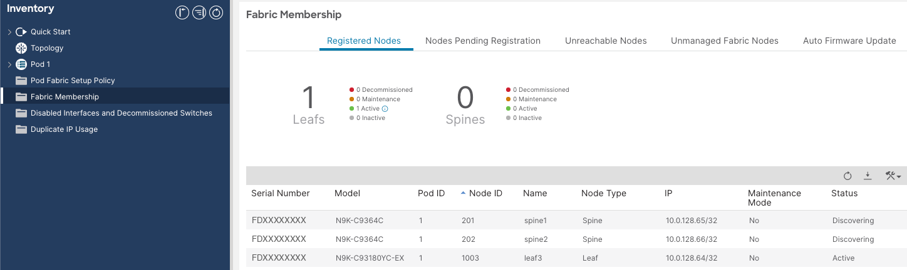

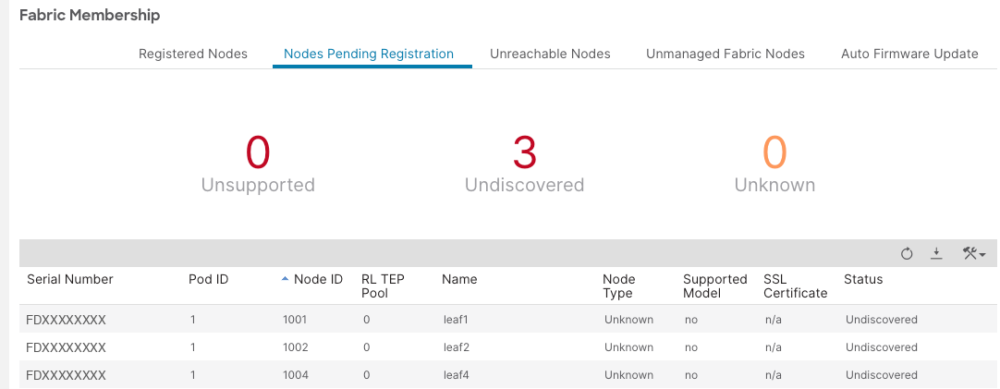

The nodes also had the out of band management IPs assigned to them.

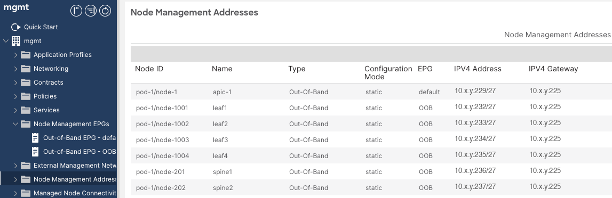

## Adding access policies

After the initial configuration has been pushed, additional configuration is done easily by declaring intent in a YAML file and ensuring that the specific ACI modules (node policies, tenants etc.) are marked as true in the `main.tf` file so that they can be managed by terraform.

Additional YAMLs files have been added to the directory to configure access policies.

```text
nac-aci-terraform/
├── main.tf
└── data/
    ├── apic.nac.yaml
    ├── defaults.nac.yaml
    ├── node_policies.nac.yaml
    ├── node_1001.nac.yaml
    ├── node_1002.nac.yaml
    └── access_policies.nac.yaml
```

With Network as Code, configuration can be split into multiple YAMLs which allows full flexibility for managing configurations. Network as Code will perform the deep merging of all the YAML files where configuration is defined. The `manage_*` flags define which parts of the fabric a Terraform project is responsible for, which helps limit the blast radius of a change: a project that only manages access policies will never plan or modify tenant configuration. Note that these flags set ownership, not a temporary filter. Once a section has been applied, setting its flag back to `false` removes it from Terraform's scope, and Terraform will plan to destroy the objects it previously created.

Below are the YAML contents required to configure access policies.

**main.tf**

```hcl
module "aci" {
  source  = "netascode/nac-aci/aci"
  version = "2.0.0"

  yaml_directories = ["data"]

  manage_access_policies    = true
  manage_fabric_policies    = true
  manage_pod_policies       = true
  manage_node_policies      = true
  manage_interface_policies = true
  manage_tenants            = false

  write_default_values_file = "defaults.yaml"
}
```

**apic.nac.yaml**

```yaml
---
apic:
  auto_generate_switch_pod_profiles: true
```

**node_1001.nac.yaml**

```yaml
apic:
  interface_policies:
    nodes:
      - id: 1001
        interfaces:
          - port: 3
            description: "Server Port"
            policy_group: SERVER_PORTS
```

**node_1002.nac.yaml**

```yaml
apic:
  interface_policies:
    nodes:
      - id: 1002
        interfaces:
          - port: 4
            description: "Server Port"
            policy_group: SERVER_PORTS
```

**access_policies.nac.yaml**

```yaml
apic:
  access_policies:

    vlan_pools:
      - name: LAB_VLANS
        allocation: static
        ranges:
          - from: 3965
            to: 3999
    physical_domains:
      - name: PDOM_LAB
        vlan_pool: LAB_VLANS

    aaeps:
      - name: AEP_LAB_01
        physical_domains:
          - PDOM_LAB
        infra_vlan: false

    interface_policies:
      lldp_policies:
        - name: LLDP-ENABLED
          admin_rx_state: true
          admin_tx_state: true
      cdp_policies:
        - name: CDP-ENABLED
          admin_state: true
      link_level_policies:
        - name: 10G-AUTO_ON
          speed: 10G
          auto: true

    leaf_interface_policy_groups:
      - name: SERVER_PORTS
        description: "Server Ports"
        type: access
        link_level_policy: 10G-AUTO_ON
        cdp_policy: CDP-ENABLED
        lldp_policy: LLDP-ENABLED
        aaep: AEP_LAB_01
    leaf_switch_policy_groups:
      - name: ALL_LEAFS
        cdp_policy: CDP-ENABLED
        lldp_policy: LLDP-ENABLED

    spine_switch_policy_groups:
      - name: ALL_SPINES
        lldp_policy: LLDP-ENABLED
        cdp_policy: CDP-ENABLED
```

An interesting point to highlight is the `apic.nac.yaml`, which contains a Network as Code based setting which allows for the auto-generation of Leaf/Spine Profiles (Fabric & Access). These are generated automatically using the module's default naming convention (for example, `LEAF<node-id>` and `SPINE<node-id>`), so the profiles were never explicitly defined in the YAML files.

The naming patterns come from the module's default values, which Terraform writes to `defaults.yaml` (see the note on `defaults.yaml` in the Testing and Validation section). The placeholder `\g<id>` is replaced with the node ID, so node 1001 becomes `LEAF1001` and node 201 becomes `SPINE201`:

**defaults.yaml**

```yaml
defaults:
  apic:
    access_policies:
      leaf_switch_profile_name: "LEAF\\g<id>"
      leaf_interface_profile_name: "LEAF\\g<id>"
      leaf_switch_selector_name: "LEAF\\g<id>"
      spine_switch_profile_name: "SPINE\\g<id>"
      spine_interface_profile_name: "SPINE\\g<id>"
      spine_switch_selector_name: "SPINE\\g<id>"
```

The profiles below were created because `auto_generate_switch_pod_profiles: true` is set in `apic.nac.yaml`, and their names follow the patterns defined in `defaults.yaml`.

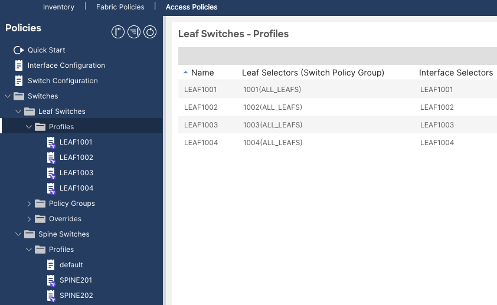

## Working with default values

Network as Code ships with sensible built-in defaults based on Cisco's best practices. In some cases, those default values might not be the best choice for a particular deployment and can be overwritten if needed. Appending suffixes to object names is a common practice that introduces room for human errors. Using default values, such suffixes can be defined once and then consistently appended to all objects of a specific type including its references. The same approach works for any attribute that should be identical across many objects. For example, in an L2-only fabric, `unicast_routing` can be disabled once in the defaults instead of being set explicitly under every bridge domain.

To validate how default value overrides behave in practice, a LAB_TENANT tenant is defined in `data/lab_tenant.nac.yaml`, containing a VRF (LAB_VRF) and three bridge domains (vlan_1001, vlan_1002, vlan_1003) associated with it. Separately, `data/defaults.nac.yaml` overrides two of the module's built-in bridge domain defaults: `name_suffix` is set to `_bd`, and `unicast_routing` is set to `false`.

**defaults.nac.yaml**

```yaml
defaults:
  apic:
    tenants:
      bridge_domains:
        name_suffix: "_bd"
        unicast_routing: false
```

**lab_tenant.nac.yaml**

```yaml
apic:
  tenants:
    - name: LAB_TENANT
      vrfs:
        - name: LAB_VRF
      bridge_domains:
        - name: vlan_1001
          vrf: LAB_VRF
        - name: vlan_1002
          vrf: LAB_VRF
        - name: vlan_1003
          vrf: LAB_VRF
```

Before running the plan, set `manage_tenants = true` in `main.tf`. In the examples so far it was set to false, so Terraform would ignore the tenant configuration and the plan would show no tenant changes.

Running `terraform plan` against this configuration confirms that both overrides are applied automatically to every bridge domain in the data model, without needing to specify them individually on each object. The plan output shows the rendered fvBD objects, with the suffix appended consistently to each bridge domain name, exactly as defined once in the defaults file.

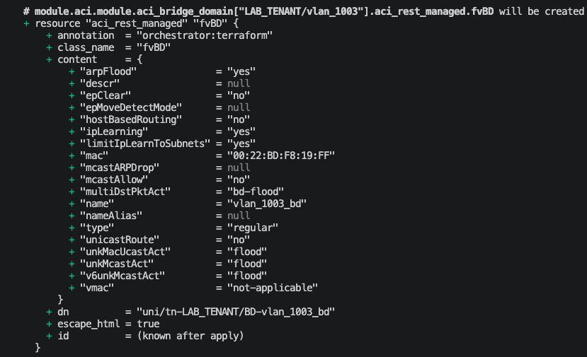

Configuration pushed to the APIC further verifies that the suffix is appended to all Bridge Domain names as desired.

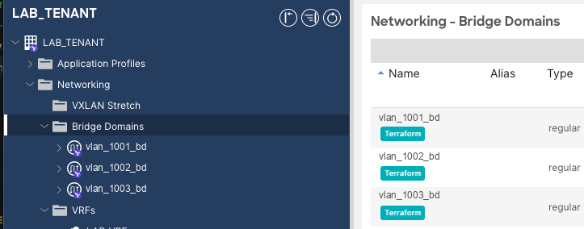

This illustrates the core value of default values in Network as Code: common conventions, such as naming suffixes, are declared a single time and propagate automatically to every matching object and its references, removing a recurring source of manual, error-prone repetition.

## Terraform State

Following the initial deployment, a Terraform statefile (`terraform.tfstate`) is created.

A Terraform state file (`terraform.tfstate`) is a JSON file Terraform writes after every apply action. It is Terraform's record of what it believes exists, i.e. every resource it created, along with the attributes it set on each one, mapped to the real object IDs in the target system (in this case, the APIC).

The YAML data model remains the source of truth for the intended configuration, while the state file is Terraform's record of what it manages. To show how Terraform uses both, a manual change was introduced directly in the APIC GUI to an object originally created by Terraform. The `admin_state` of the CDP-ENABLED interface policy was toggled from enabled to disabled through the APIC UI, outside of the Network as Code workflow.

**Terraform change**

```yaml
cdp_policies:
  - name: CDP-ENABLED
    admin_state: true
```

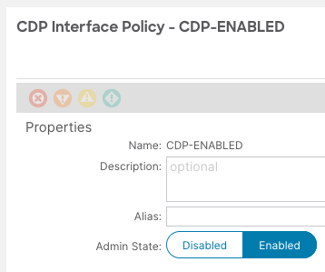

**Manual override on the GUI**

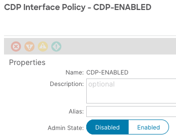

The Terraform state file was not automatically updated to reflect this change, since the manual change bypassed Terraform entirely. Running `terraform plan` afterward detects a deviation.

```text
nac-aci-terraform % terraform plan

….

Terraform used the selected providers to generate the following execution plan. Resource
actions are indicated with the following symbols:

  ~ update in-place

Terraform will perform the following actions:

  # module.aci.module.aci_cdp_policy["CDP-ENABLED"].aci_rest_managed.cdpIfPol will be updated in-place

  ~ resource "aci_rest_managed" "cdpIfPol" {
      ~ content     = {
          ~ "adminSt" = "disabled" -> "enabled"
            # (1 unchanged element hidden)
        }
        id          = "uni/infra/cdpIfP-CDP-ENABLED"
        # (4 unchanged attributes hidden)
    }
Plan: 0 to add, 1 to change, 0 to destroy.
```

Terraform refreshed the object's current state from the APIC, compared it with the state file, and then compared the YAML configuration against it. The APIC reports `admin_state` as disabled while the YAML declares it as enabled, so Terraform proposed reverting it to enabled so that the infrastructure matches the YAML. This three-way comparison between the YAML (desired state), the state file (what Terraform last applied) and the APIC (actual state) shows that the YAML, not the live infrastructure, is the source of truth. The difference appears because the YAML declares `admin_state: true`, not because of anything stored in the state file.

!!! note
    In this lab, the state file lives on the engineer's local machine, inside the `nac-aci-terraform` project folder. That is acceptable for learning the workflow, but it does not scale to a team, and it does not belong in a production process: a single laptop becomes a single point of failure, holding the only copy of the state, which no one else can see or safely edit. Once this workflow moves into Git and a CI/CD pipeline, covered in the next article, the state file no longer lives on any one engineer's machine. It is stored in a remote backend, in this case GitLab's managed Terraform state backend, so that the pipeline itself, not an individual laptop, always reads and writes one shared state for the fabric.

The next section of this lab will go into the Testing and Validation framework that is a key element of Network as Code.

## Testing and Validation – Network as Code

Network as Code introduces a complete engineering lifecycle, with validation before deployment and testing after deployment. This is one of the major advantages of the Cisco Network as Code framework because rather than simply generating Terraform code and applying changes to Cisco ACI, the framework introduces validation throughout the entire infrastructure lifecycle. NaC offers tools for automated pre-deployment validation and post-deployment validation.

### Pre-Change Validation

Pre-change/pre-deployment validation is the process within the engineering lifecycle whereby a proposed change is validated before any configuration has touched the infrastructure. Network as Code offers a CLI tool called `nac-validate` for pre-change validation. The `nac-validate` tool is executed before configuration deployment to validate that the configuration files do not contain any syntax, semantic or logical errors. The intention is to fail fast: errors are caught at this pre-change stage, rather than waiting for the configuration to fail during the maintenance window.

The `nac-validate` tool can be found here: [https://github.com/netascode/nac-validate](https://github.com/netascode/nac-validate)

Before infrastructure changes are deployed, `nac-validate` analyzes the desired configuration to ensure it satisfies a series of increasingly sophisticated validation stages. Instead of waiting for Cisco ACI to reject invalid objects or generate faults after deployment, many issues can be detected early within the lifecycle.

The pre-change validation process typically focuses on the following core areas:

- **Format Validation** – verifies the YAML documents are correctly formatted.
- **Syntax Validation** – ensures the YAML conforms to the expected schema and data types.
- **Semantic Validation** – validates logical consistency and referential integrity between objects.
    - Naming standards
    - IP address format
    - Overlapping subnets
    - Complex validations across multiple objects
- **Compliance Validation** – verifies an organization-specific policies and governance requirements.

Each stage examines the configuration from a different perspective and progressively increases confidence that the proposed change is safe to deploy. Gone are the days when "let's see what happens" counted as pre-change validation.

Let's walk through some examples to see pre-change validation in action during the YAML (intent) development stage. This is before the "nac-validate" CLI tool is officially executed to provide validation across all YAMLs. The checks in these examples are provided by the Visual Studio Code YAML plugin, which validates files with the `.nac.yaml` extension against the Network as Code data model as you type. They are unrelated to, and independent of, the `nac-validate` tool.

#### Example 1: YAML Format validation

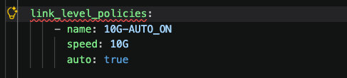

Any indentation violations are detected allowing the engineer to refine the YAML format.

#### Example 2: Syntactic schema validation

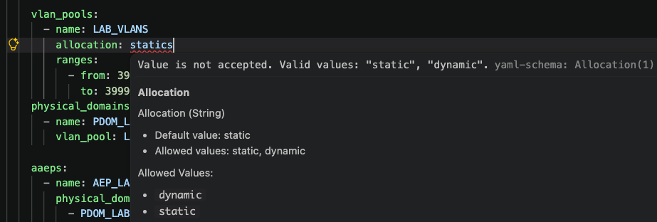

In this example, an incorrect value was put in a YAML file and this violation is already highlighted because specific keys have specific values that they accept & Network as Code ensures that these validations are adhered to.

#### Example 3: Required Fields and Schema Validation

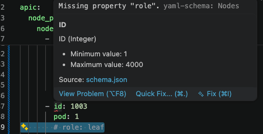

In this example, the key:value (`role: leaf`) which is a mandatory attribute was removed. This was already flagged to the user that there is a missing property. This is quite key because mistakes are caught way earlier within the lifecycle.

#### Example 4: Objects Validations against the schema

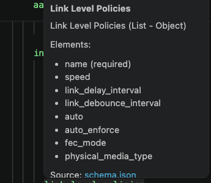

#### Example 5: Invalid VLAN ID in the data model

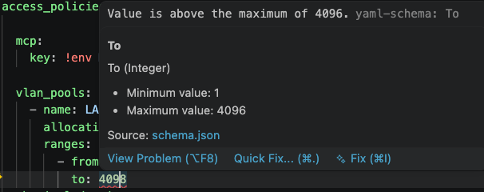

In this example a VLAN ID (4098) was defined which goes beyond the boundaries of the maximum VLAN ID (4096). The pre-validation tool flags this immediately.

Since the files are defined with the ".nac.yaml" extension, this offers a help context during the YAML development. Just by hovering over a property, in this case `link_level_policies:` the user can see the attributes that are required/allowed within that specific section of the configuration. This allows the user to quickly build up a valid intent that does not violate the data model.

#### Running nac-validate

Now let's run the "nac-validate" CLI tool to see it in action. Unlike the Visual Studio Code plugin, which runs on a laptop and helps while the YAML files are being created, `nac-validate` performs a comprehensive check of all the files, covering both syntax and semantics (semantic validation is not done by the plugin), and can be executed on any machine, including the one running the pipeline.

!!! note
    The `data/` folder, where the YAML files are defined, is freely available (for example, in the [nac-aci-comprehensive-example](https://github.com/netascode/nac-aci-comprehensive-example) repository). The `.schema.yaml` file and the `.rules/` directory used in this command are not publicly available. They are provided to customers with a Services as Code subscription and are placed in the project root. Cisco Services as Code is available through Cisco Professional Services as an annual subscription service. To get started, contact your account representative or authorized Cisco partner today ([Services as Code At-a-Glance](https://www.cisco.com/c/en/us/services/collateral/se/services-as-code-aag.html)).

The following CLI command is executed

```bash
nac-validate data/ -s .schema.yaml -r .rules/ --format json
```

The above command:

1. Reads all YAML input files under `data/` folder and builds one inventory model.
2. Checks structure/types with `.schema.yaml` (required fields, value types, ranges, regex patterns, valid nesting).
3. Runs custom Python rules in `.rules/` (business logic checks like references, uniqueness, cross-section consistency).
4. Collects all findings into categories like schema/syntax vs semantic rule violations.
5. Prints the result as JSON because of `--format json`.

!!! note
    - The `.schema.yaml` is a schema definition that describes the expected shape and types of the data model. It does not perform any checks itself: `nac-validate` uses it to verify that fields exist where required, that values are the right type/range/format, and that nesting matches the model.
    - The `.rules/*.py` files do semantic and cross-object validation: logic that schema alone can't express cleanly, like uniqueness across lists, reference integrity between sections, and custom policy behavior.
    - The `--format json` option is optional and a matter of personal preference. Without it, `nac-validate` prints its default plain CLI output, which works just as well.

To test the `nac-validate` towards a configuration rule violation, I have defined a data model (intent) which assigns a `fabric_policy_group` attribute to the nodes (leafs and spines) however without this policy group defined anywhere else.

```yaml
---
apic:
  node_policies:
    nodes:
      - id: 1001
        pod: 1
        role: leaf
        serial_number: FDXXXXXXXX
        name: leaf1
        oob_address: 10.x.y.232/27
        oob_gateway: 10.x.y.225
        fabric_policy_group: ALL_LEAFS
        access_policy_group: ALL_LEAFS
```

The `nac-validate` is able to flag this rule violation, allowing an engineer to make the appropriate object references before pushing the configuration to the controller.

```text
nac-aci-terraform % nac-validate data/ -s .schema.yaml -r .rules/ --format json
```

```json
{
  "syntax_errors": [],
  "semantic_errors": [
    {
      "rule_id": "202",
      "description": "Verify Fabric Leaf Switch Policy Group references",
      "severity": "HIGH",
      "errors": [
        {
          "message": "apic.node_policies.nodes.fabric_policy_group - ALL_LEAFS"
        },
        {
          "message": "apic.node_policies.nodes.fabric_policy_group - ALL_LEAFS"
        },
        {
          "message": "apic.node_policies.nodes.fabric_policy_group - ALL_LEAFS"
        },
        {
          "message": "apic.node_policies.nodes.fabric_policy_group - ALL_LEAFS"
        }
      ]
    },
    {
      "rule_id": "203",
      "description": "Verify Fabric Spine Switch Policy Group references",
      "severity": "HIGH",
      "errors": [
        {
          "message": "apic.node_policies.nodes.fabric_policy_group - ALL_SPINES"
        },
        {
          "message": "apic.node_policies.nodes.fabric_policy_group - ALL_SPINES"
        }
      ]
    }
  ]
}
```

The fix for this requires the definition of the missing `fabric_policy_group` to be defined along with its relevant policies.

**main.tf**

```hcl
module "aci" {
  source  = "netascode/nac-aci/aci"
  version = "2.0.0"

  yaml_directories = ["data"]
  manage_access_policies    = true
  manage_fabric_policies    = true
  manage_pod_policies       = true
  manage_node_policies      = true
  manage_interface_policies = true
  manage_tenants            = false

  write_default_values_file = "defaults.yaml"
}
```

**fabric_policies.nac.yaml**

```yaml
apic:
  fabric_policies:
    switch_policies:
      psu_policies:
        - name: COMBINED
          admin_state: combined

    leaf_switch_policy_groups:
      - name: ALL_LEAFS
        psu_policy: COMBINED

    spine_switch_policy_groups:
      - name: ALL_SPINES
        psu_policy: COMBINED
```

Now that the fabric spine/switch policy groups have been defined, in this example with a power supply policy (optional) associated with the groups, the `nac-validate` will be executed again to validate if there are any missing references in the data model.

```text
nac-aci-terraform % nac-validate data/ -s .schema.yaml -r .rules/

────────────────────────────────────────────────────
Validation Summary
────────────────────────────────────────────────────
  ✓ Syntax validation: PASSED (7 files)
  ✓ Semantic validation: PASSED
```

Network as Code allows for custom rules/policy enforcement whereby an organization can define its own objects naming conventions, IP addressing schemes, security and regulatory compliance etc.

In the example below, a simple custom naming convention rule was created which only accepts the name "BFD-IPV4-POLICY" when defining a BFD IPv4 policy. To test that the rule is indeed enforced, the BFD policy name before has been defined as "BFD-POLICY" which does not conform to the required convention.

**access_policies.nac.yaml**

```yaml
apic:
  access_policies:
    switch_policies:
      bfd_ipv4_policies:
        - name: BFD-POLICY
          description: BFD IPv4 Policy
          detection_multiplier: 5
          min_transmit_interval: 100
```

When the `nac-validate` is executed, the rule enforcement is triggered:

```text
nac-aci-terraform % nac-validate data/ -s .schema.yaml -r .rules/ --format json
```

```json
{
  "syntax_errors": [],
  "semantic_errors": [
    {
      "rule_id": "500",
      "description": "Verify BFD IPv4 Policy naming convention",
      "severity": "HIGH",
      "errors": [
        {
          "message": "apic.access_policies.switch_policies.bfd_ipv4_policies.name - BFD-POLICY does not follow the naming convention. Name must be 'BFD-IPV4-POLICY'"
        }
      ]
    }
  ]
}
```

After the fix has been put in place in the data model, all pre-validation checks pass.

**access_policies.nac.yaml**

```yaml
apic:
  access_policies:
    switch_policies:
      bfd_ipv4_policies:
        - name: BFD-IPV4-POLICY
          description: BFD IPv4 Policy
          detection_multiplier: 5
```

**nac-validate checks**

```text
nac-aci-terraform %
nac-validate data/ -s .schema.yaml -r .rules/
────────────────────────────
Validation Summary
────────────────────────────
  ✓ Syntax validation: PASSED (7 files)
  ✓ Semantic validation: PASSED
```

This pre-validation summary result provides the exact confidence required before pushing configuration to the infrastructure.

### Post-Change Validation

This section introduces the post-change validation framework and tool offer by Network as Code. There are certain aspects that can only be verified/tested after configuration has been pushed to the environment e.g. the actual operational state. Network as Code has a specific tool for post-change validation which is `nac-test`.

The `nac-test` tool can be found here: [https://github.com/netascode/nac-test](https://github.com/netascode/nac-test)

!!! note
    `nac-test` itself is publicly available. The test templates it renders and executes (referenced later with the `-t tests/templates` option) are not publicly available and require a Services as Code subscription ([Services as Code At-a-Glance](https://www.cisco.com/c/en/us/services/collateral/se/services-as-code-aag.html)). The examples in this section show what is possible with the subscription.

A successful configuration deployment is certainly a win. However, the reality is that successfully pushing configuration does not necessarily mean the network has reached its intended operational state. The APIC may have accepted the configuration, but that alone does not prove that the network is actually working as intended.

This is where post-change validation becomes critical. Network as Code does not treat validation as an afterthought. The `nac-test` tool provides a way to automate the verification of the network after configuration has been deployed, allowing the intended configuration as part of the same automation lifecycle.

`nac-test` can render and execute automated tests using both Robot Framework and pyATS, with test suites driven by the same YAML data model used to describe the network intent. This enables validation to move beyond simply asking "Did the configuration deploy?" toward the far more important question:

> "Did the network actually become what we intended it to become?"

The specific test cases that are executed are not generic as they are dynamically rendered based on the defined data model. The set of post-change test cases can be classified under the following categories.

**Configuration Tests**
:   Verify that the desired configuration has been successfully rendered within Cisco ACI.

**Health Tests**
:   Verify that the infrastructure remains healthy following the deployment and that no new faults or degradation have been introduced.

```text
nac-aci-terraform % nac-test -d ./data -d ./defaults.yaml -t tests/templates -f tests/filters -o tests/results
📄 Merging data model files...
✅ Data model merging completed (< 1s)

🤖 Running Robot Framework tests...

📝 Rendering Robot Framework templates...
🤖 Executing Robot Framework tests...
… output truncated

2026-08-08 12:16:38.395904 [PID:2606] [6] [ID:48] PASSED Robot Results.Config.Node Policies.Vpc Group in 1.6 seconds
2026-08-08 12:16:38.961951 [PID:2604] [4] [ID:46] PASSED Robot Results.Config.Node Policies.Node Registration in 2.2 seconds
2026-08-08 12:16:38.992718 [PID:2605] [5] [ID:47] PASSED Robot Results.Config.Node Policies.Oob Node Address in 2.2 seconds
140 tests, 140 passed, 0 failed, 0 skipped.
===================================================
Output:   nac-aci-terraform/tests/results/robot_results/output.xml
XUnit:    nac-aci-terraform/tests/results/robot_results/xunit.xml
Log:      nac-aci-terraform/tests/results/robot_results/log.html
Report:   nac-aci-terraform/tests/results/robot_results/report.html
Finalizing Pabot execution...
Stopping PabotLib process
Robot Framework remote server at 127.0.0.1:60373 stopped.
PabotLib process stopped
Total testing: 1 minute 32.80 seconds
Elapsed time:    8.77 seconds
Logs flushed successfully.

======================================================================
Combined Test Execution Summary
----------------------------------------------------------------------
140 tests, 140 passed, 0 failed, 0 skipped.
----------------------------------------------------------------------
Dashboard:    nac-aci-terraform/tests/results/combined_summary.html
Robot:        nac-aci-terraform/tests/results/robot_results/log.html
xUnit:        nac-aci-terraform/tests/results/xunit.xml
```

!!! note "A note on defaults.yaml (referenced in the nac-test command)"
    The `nac-test` command above references two data sources: `./data`, which holds the intent-based configuration you author, and `./defaults.yaml`, which supplies the module's effective default values for anything you did not explicitly override.

    The `defaults.yaml` is generated automatically by Terraform as a side effect of `terraform apply`, via the module's `write_default_values_file` setting (configured in this project's `main.tf`). It captures the built-in defaults defined by the `nac-aci` module, merged with any overrides that were made in `data/defaults.nac.yaml`. Test templates validate configuration against the values that were applied; including defaulted ones, so `nac-test` needs both the explicit intent and the resolved defaults to build accurate test assertions.

    Because this file is generated, it is only as current as your last apply. It should be regenerated whenever the module version changes, so newly introduced default fields stay in sync.

The `nac-test` produces artifacts that are easy to consume. A `log.html` is one of the most important artifacts that one can go through to analyze the post-validation result.

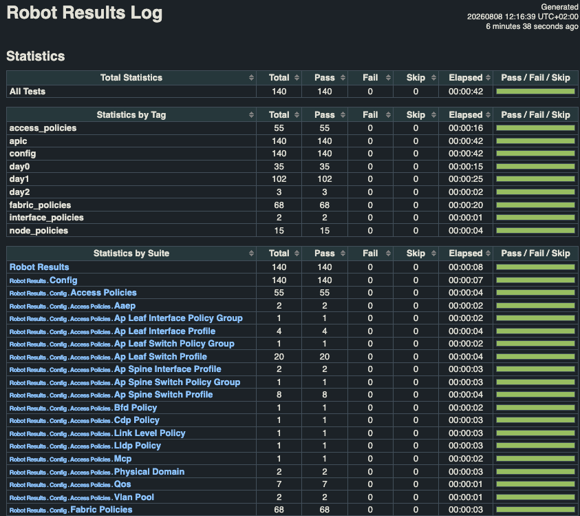

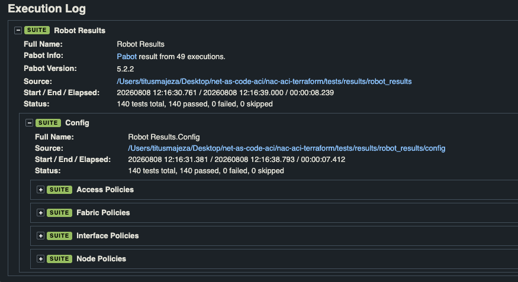

The HTML offers a high-level summary of test cases that were executed and an interactive capability for the user to dig in a specific Suite for low level details of each test case that was executed.

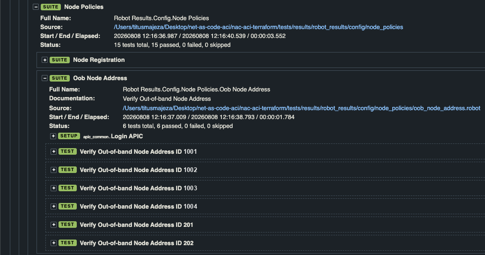

## Catching Configuration Drifts

To validate that `nac-test` catches configuration drift, the `admin_state` field of the CDP-ENABLED interface policy in `data/access_policies.nac.yaml` was changed from true to false, without running `terraform apply`. This introduced a deliberate mismatch: the data model now declared CDP as disabled, while the APIC still had it enabled from the last actual deployment. Editing the YAML is a simple, lightweight way to simulate drift, and a softer demonstration than a real out-of-band change on the APIC, which is described below.

```text
nac-aci-terraform % nac-test -d ./data -d ./defaults.yaml -t tests/templates -f tests/filters -o tests/results
📄 Merging data model files...
✅ Data model merging completed (< 1s)

🤖 Running Robot Framework tests...

📝 Rendering Robot Framework templates...
🤖 Executing Robot Framework tests...

… output truncated

2026-08-08 13:21:20.203232 [PID:75703] [4] [ID:9] Execution failed in Robot Results.Config.Access Policies.Cdp Policy with 1 failing test(s)
==============================================================================
Robot Results
==============================================================================
Robot Results.Config
==============================================================================
Robot Results.Config.Access Policies
==============================================================================
Robot Results.Config.Access Policies.Cdp Policy :: Verify CDP Interface Policy
==============================================================================
Verify CDP Interface Policy CDP-ENABLED                               | FAIL |
enabled != disabled
------------------------------------------------------------------------------
Robot Results.Config.Access Policies.Cdp Policy :: Verify CDP Inte... | FAIL |
1 test, 0 passed, 1 failed
==============================================================================
Robot Results.Config.Access Policies                                  | FAIL |
1 test, 0 passed, 1 failed
==============================================================================
Robot Results.Config                                                  | FAIL |
1 test, 0 passed, 1 failed
==============================================================================
Robot Results                                                         | FAIL |
1 test, 0 passed, 1 failed
==============================================================================

======================================================================
Combined Test Execution Summary
----------------------------------------------------------------------
140 tests, 139 passed, 1 failed, 0 skipped.
----------------------------------------------------------------------
```

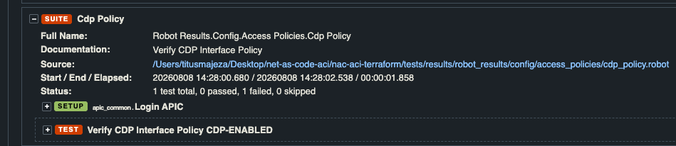

Running the `nac-test` against this state produced a failure on the Configuration Test for that policy, since the test validated the fabric against the current data model rather than what was last applied. The result confirmed that post-change validation correctly surfaces drift between declared intent and deployed state.

In practice, the more common source of drift is an out-of-band change: i.e. someone logs in to the APIC and changes a setting manually. This is the same situation shown in the Terraform State section, where the `admin_state` of the CDP-ENABLED policy was toggled in the APIC GUI. Because the data model still declares the intended value, running `nac-test` would flag the mismatch on the corresponding configuration test and identify exactly which object differs, even though nothing was changed in the YAML files. Catching these manual changes is what makes post-change validation valuable beyond a single deployment.

## Version Control & CI Pipeline

Every YAML file in this data model is plain text, which means it can be tracked in Git. Every change becomes visible, reviewable, and reversible, turning the repository into a logbook of why, when, and by whom the change was made. The next article picks this up in full, version controlling this data model in Git, and wiring that repository into a CI/CD pipeline so every change is automatically validated, tested, and deployed without a manual `terraform apply` run from a laptop.

## Start Your Network as Code Journey Today

To quickly get started with Network as Code for ACI deployment and validation, you can clone either of the following repositories.

- Simple Example: [https://github.com/netascode/nac-aci-simple-example](https://github.com/netascode/nac-aci-simple-example)
- Comprehensive Example: [https://github.com/netascode/nac-aci-comprehensive-example](https://github.com/netascode/nac-aci-comprehensive-example)

Both provide a preconfigured directory structure with example configurations, giving you a ready-to-use starting point that can be modified to suit your environment.

## References

1. Network as Code official website: [https://netascode.cisco.com](https://netascode.cisco.com)
2. Cisco Live Sessions:
    - Deploy Network Changes with Confidence: Test and Validation with Network as Code - BRKOPS-1603
    - Network as Code - Kick-Start Your Automation with ACI - BRKDCN-2673
    - A Beginner's Guide to Network as Code for ACI - DEVNET-1202
3. Cisco official Whitepapers:
    - [https://www.cisco.com/c/en/us/solutions/collateral/executive-perspectives/technology-perspectives/automate-network-infrastructure-code-wp.html](https://www.cisco.com/c/en/us/solutions/collateral/executive-perspectives/technology-perspectives/automate-network-infrastructure-code-wp.html)
